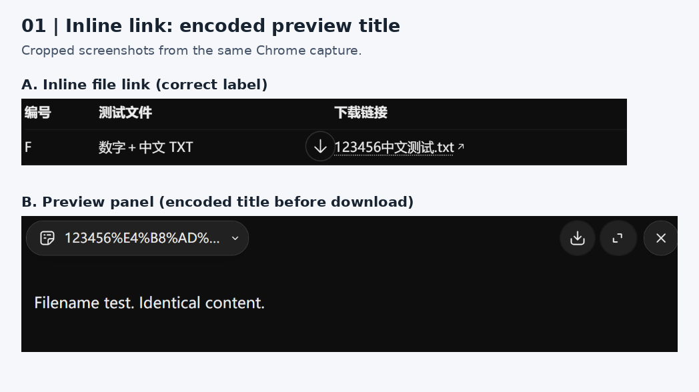
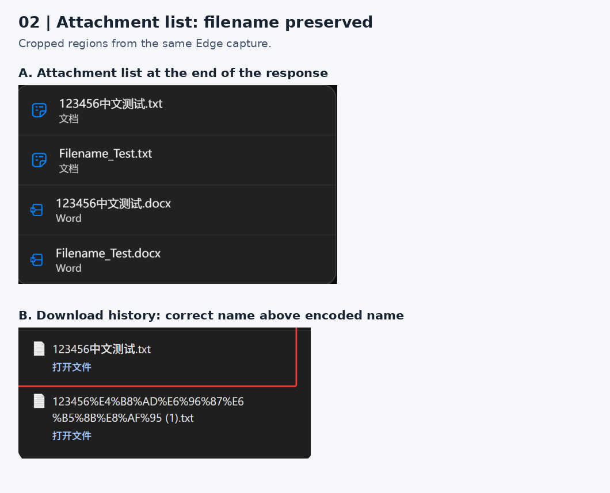
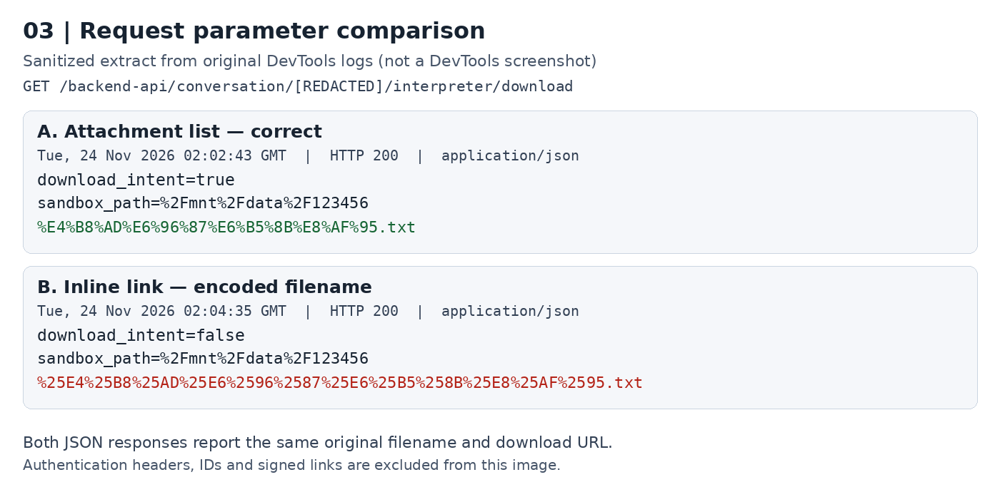
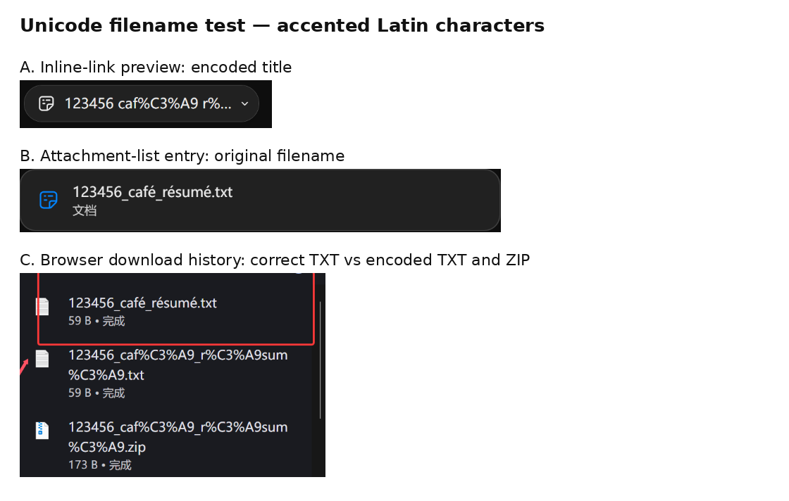
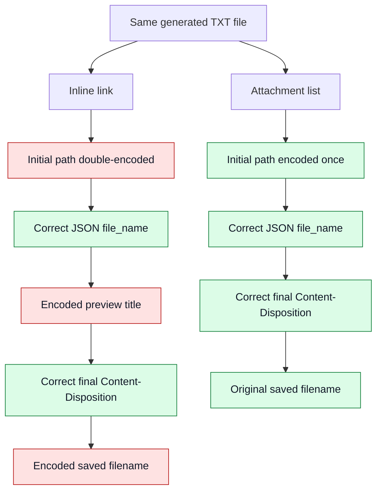

# ChatGPT Web · Unicode filename encoding bug

> A reproducible, evidence-driven investigation of inconsistent generated-file downloads.


[中文说明](README.zh-CN.md) · [Sanitized network evidence](docs/network-evidence.md) · [Reproduction guide](docs/reproduction.md) · [Status and timeline](docs/timeline.md)

## At a glance

On November 24, 2026, I reproduced a generated-file filename bug in ChatGPT Web. The **same file, in the same conversation and browser**, receives different saved names depending on which download entry point is used.

| Inline link / preview | Response-bottom attachment |
| --- | --- |
| `123456%E4%B8%AD%E6%96%87%E6%B5%8B%E8%AF%95.txt` | `123456中文测试.txt` |
| Encoded name visible before saving | Original filename preserved |

**Key evidence:** The initial request contains a double-encoded path on the affected route, while both initial JSON responses return the correct canonical filename and both subsequent TXT file-content responses return the same valid UTF-8 `filename*` header. The exact faulty client function has not been verified.

**Status:** Reported to OpenAI; AI-assisted Support acknowledged recording the bug and evidence. No case number, engineering escalation, or fix has been confirmed.

## Visual evidence

### 01 — Inline-link preview already shows an encoded filename



The issue is visible before the browser saves the file.

### 02 — Same file, alternate download entry point



The response-bottom attachment download preserves the Chinese name; the inline route does not.

### 03 — Network request comparison



This is a reconstructed comparison based on captured logs, not an original DevTools screenshot.

### 04 — Accented Latin characters and ZIP



The affected route also encodes `é` as `%C3%A9`. ZIP inline downloads bypass the document preview yet still save the encoded filename.

## Diagnostic model



The diagram summarizes observations, not verified implementation details. A plausible explanation is that the inline route reuses an encoded path-derived filename rather than canonical metadata, including when saving a programmatically downloaded file.

## Test matrix

| Test | Inline result | Attachment-list result |
| --- | --- | --- |
| Chinese TXT | Preview and saved name encoded | Correct |
| Chinese DOCX | Preview and saved name encoded | Correct |
| Chinese ZIP | Direct download; name encoded | Not established |
| Digits + Chinese TXT | Chinese portion encoded | Correct |
| Digits + Chinese DOCX | Chinese portion encoded | Correct |
| ASCII TXT / DOCX | Normal preview names | Not separately recorded |
| ASCII ZIP | Correct saved name | Not separately recorded |
| Accented Latin TXT | Preview and saved name encoded | Correct |
| Accented Latin ZIP | Direct download; name encoded | Not available in that test |

Environment: Windows 11; Chrome 157.0.8103.79; Edge 158.0.4370.33 (64-bit); ChatGPT Plus, Simplified Chinese UI; no third-party download manager used. The legacy domain redirects to chatgpt.com. Both Chromium browsers reproduced the issue; other browser engines were not tested.

## Reproduce locally

Use the [reproduction guide](docs/reproduction.md) in ChatGPT Web, or inspect the offline encoding demonstration:

```bash
node repro/encoding-demo.mjs
node --test repro/encoding-demo.test.mjs
```

The demo has no dependencies or network access. It illustrates the observed encoding discrepancy only; it does not reproduce or patch ChatGPT internals.

## Report and follow-up

- [Public OpenAI Developer Community report](https://community.openai.com/t/chatgpt-web-double-url-encoding-of-unicode-filenames-in-inline-file-downloads/1419940)
- OpenAI Help Center: AI-assisted Support recorded the findings and four evidence images (November 24, 2026).
- [Investigation timeline](docs/timeline.md)
- Workaround: use the response-bottom attachment download when available, or use ASCII filenames.

## Privacy and scope

This is an independent user investigation, not an official OpenAI repository, security vulnerability disclosure, or confirmed source-code diagnosis. Only reviewed crops and redacted excerpts are published. Raw HAR files, authentication headers, cookies, signed download URLs, private conversations, and personal account identifiers are intentionally excluded. Do not attach unredacted logs when reporting reproductions.

If you can reproduce the issue, an anonymized environment, expected/actual filename, and download entry point are useful. Please do not post secrets.