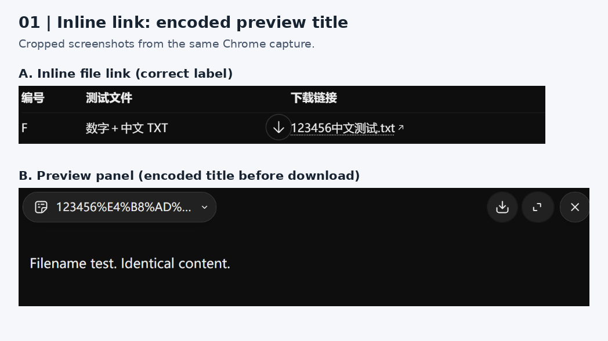
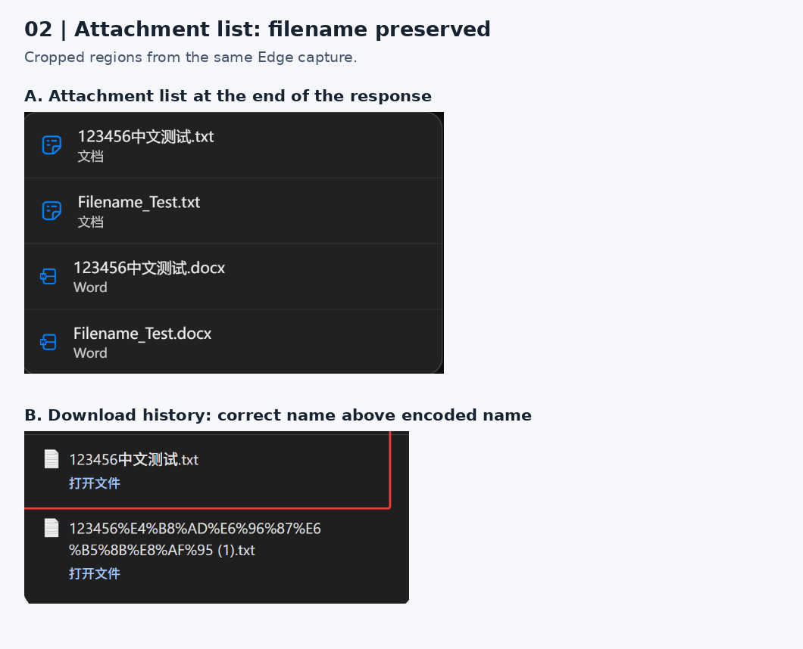
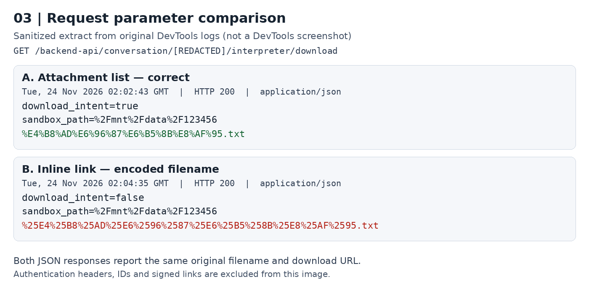
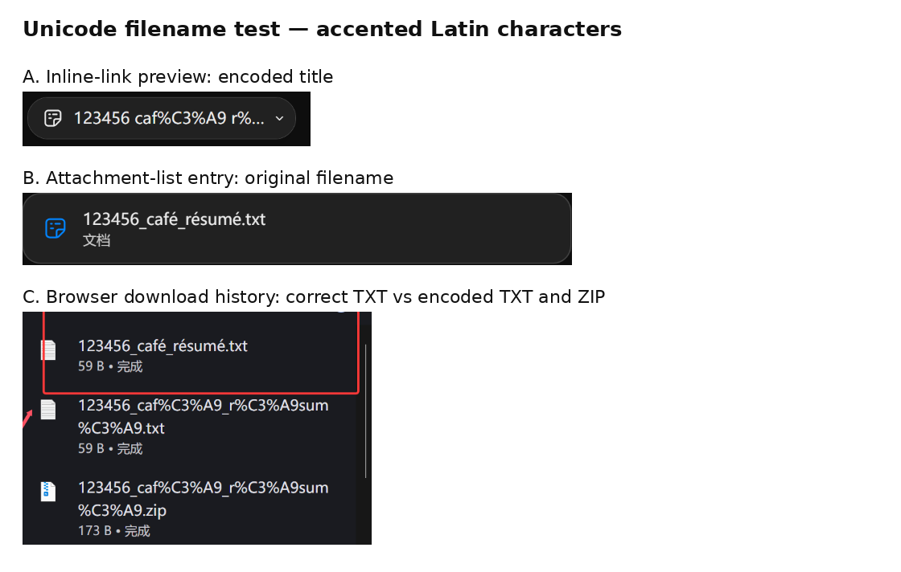

# ChatGPT 网页端 Unicode 文件名编码缺陷调查

[English README](README.md) · [网络证据](docs/network-evidence.md) · [复现指南](docs/reproduction.md) · [反馈时间线](docs/timeline.md)

## 摘要

2026 年 11 月 24 日，在 Windows 11 的 Chrome 和 Edge 中，通过同一文件、同一会话、不同下载入口进行对照实验，确认 ChatGPT 正文中的文件链接会导致非 ASCII 文件名被保留为百分号编码，而回复末尾附件列表下载可正常保留原始名称。中文及带重音拉丁字母均已复现。

| 项目 | 已验证结果 |
| --- | --- |
| 正文 TXT、DOCX 链接 | 预览名称异常，保存后名称异常 |
| 正文 ZIP 链接 | 不打开预览，直接下载时名称异常 |
| 末尾附件列表（TXT、DOCX） | 正常保留原名 |
| 初始请求 | 正文路径中的百分号被再次编码为 %25 |
| 初始 JSON 响应 | 两条路径返回相同且正确的 file_name |
| 最终 TXT 文件响应 | 两条路径的 Content-Disposition / filename* 相同且正确 |
| 客服反馈 | AI 客服表示已登记并补充全部证据；未确认工程团队接手或修复 |

## 图文证据

### 正文链接预览

### 末尾附件下载

### 初始请求参数对比

此图是根据抓包日志制作的对照图，不是原始 DevTools 截图。

### 非中文 Unicode 测试

## 技术结论

当前证据指向正文链接共享的文件名处理逻辑：初始请求存在二次编码，而文件名元数据及最终 TXT 响应头均正确。客户端可能使用了路径派生的已编码文件名，而不是后端提供的规范名称。ZIP 不经过预览仍发生异常，说明问题不局限于预览组件。

这只是基于观测的根因假设，尚未验证产品源码，也不能断言所有 Unicode 字符和浏览器均受影响。

## 复现与反馈

[官方开发者社区帖子](https://community.openai.com/t/chatgpt-web-double-url-encoding-of-unicode-filenames-in-inline-file-downloads/1419940)

临时方案：优先使用回复末尾附件列表下载，或使用 ASCII 文件名。

仓库只收录经过核对的脱敏图片、技术摘录及离线演示。原始抓包、私人聊天、账户认证凭证和带签名的链接不公开。本仓库是独立用户的工程调查记录，不代表 OpenAI 官方结论。